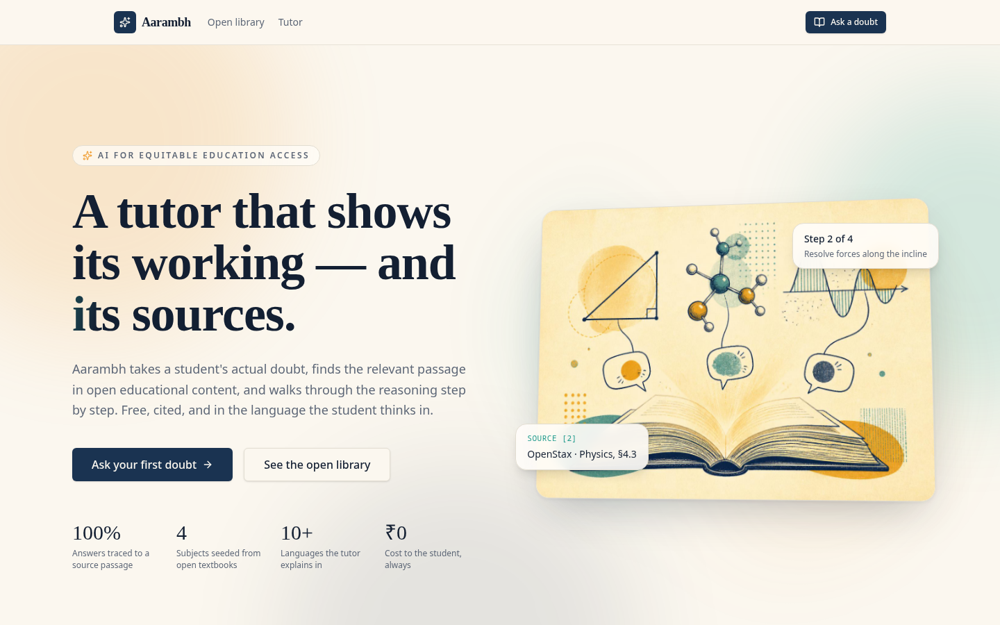
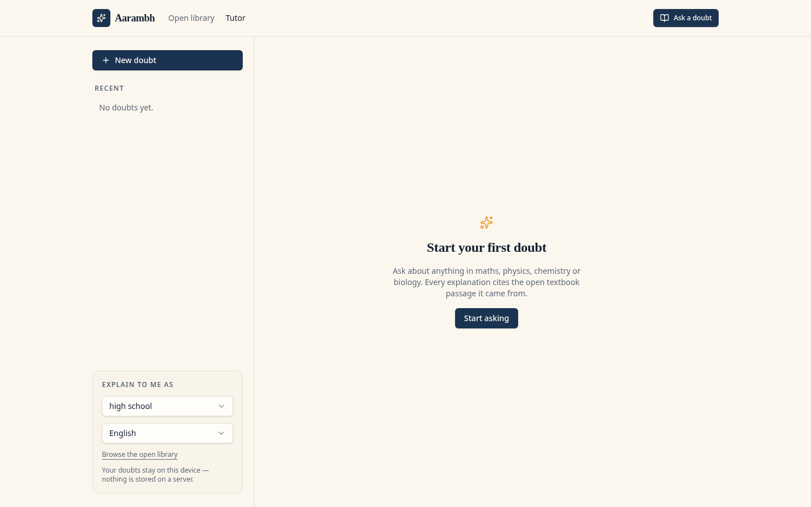
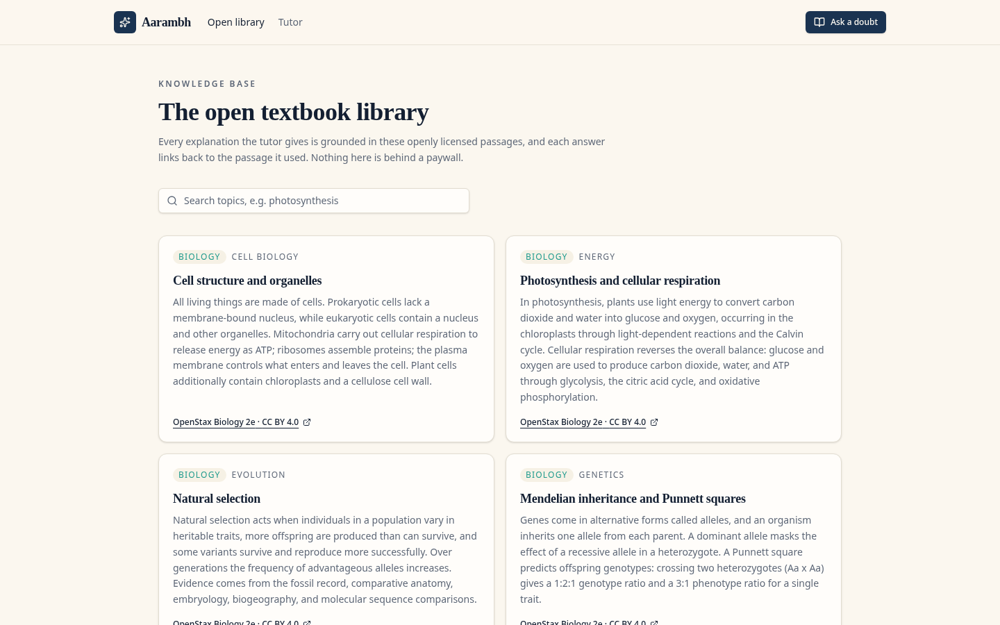

# Aarambh — AI tutoring grounded in open textbooks

Aarambh is an AI tutor built for equitable education access. It answers a student's actual doubt by first retrieving relevant passages from openly licensed educational content, then explaining step-by-step with inline citations. It can adapt its language and grade level, and keeps all conversations locally in the browser.

Built for **Problem Statement 2: AI for Equitable Education Access** — focused on education, language access, and personalized learning.

---

## Screenshots

### Landing page



### Ask a doubt



### Open textbook library



---

## What it does

- **Cited answers**: Every explanation is grounded in passages from open textbooks and links back to the source.
- **Grade & language aware**: Set your grade level and language once; every answer is re-pitched to match.
- **Privacy-first**: No accounts required. Conversations and preferences stay in the browser's local storage.
- **Open library**: Browse all source passages in one place, with direct links to the original open content.

## Tech stack

- **Frontend**: TanStack Start, React 19, Tailwind CSS v4
- **AI**: Lovable AI Gateway (`openai/gpt-5.6-sol`) via `@ai-sdk/react`
- **Backend / database**: Lovable Cloud (Supabase) — used for the open textbook library and metadata
- **Search**: PostgreSQL full-text search (`tsvector` + GIN index) over source passages
- **Styling**: Custom "Chalk & Parchment" design system with 3D-tilt and scroll-reveal animations

## Project structure

```text
src/
  components/
    site-header.tsx          # Navigation header
    reveal.tsx               # Scroll-reveal animation wrapper
    tutor/
      chat-panel.tsx         # Main AI chat interface
      message-view.tsx       # Markdown + citation rendering
  routes/
    index.tsx                # Landing page
    tutor.tsx                # Public AI tutor
    library.tsx              # Searchable open textbook library
    api/chat.ts              # Streaming AI chat handler
  lib/
    ai-gateway.server.ts     # Lovable AI Gateway configuration
    retrieval.server.ts      # Keyword-based passage retrieval
    library.functions.ts     # Server functions for library data
  styles.css                 # Design tokens, 3D utilities, animations
```

## Development

```sh
npm i
npm run dev
```

The dev server runs at `http://localhost:8080`.

## Built with Lovable

This project was built with [Lovable](https://lovable.dev). Continue developing it in the [Lovable editor](https://lovable.dev/projects/a2a64e33-9967-483a-80b6-b34567f75c5b).

- **Ship faster**: describe what you want to build and Lovable handles the code.
- **Stay in sync**: every change made in Lovable is committed straight to this repository.
- **Full ownership**: this code is yours. Push to `main` on GitHub and your changes sync back into Lovable, ready for your next prompt.
